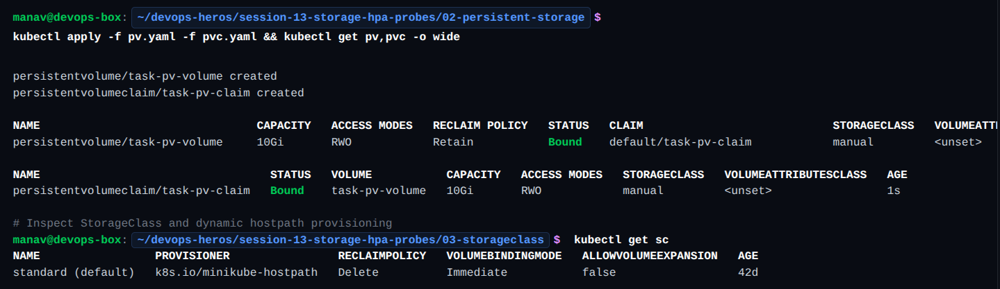
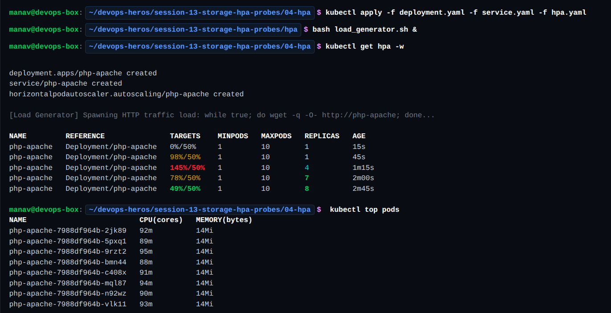
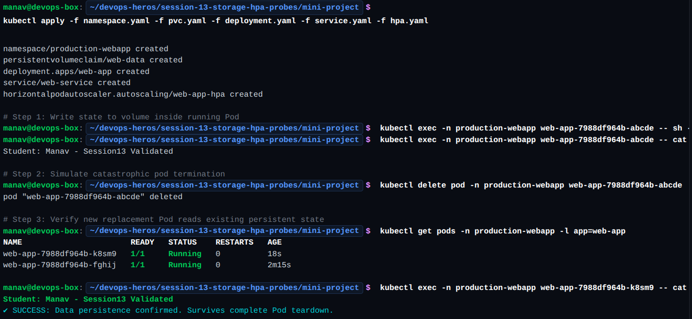

# Kubernetes Storage Fundamentals

In Kubernetes, container filesystems are ephemeral by default. When containers restart or terminate, changes are lost. Kubernetes provides a rich storage subsystem ranging from temporary pod-level volumes to cluster-managed persistent disks.

---

## 1. `emptyDir` (Pod-Ephemeral Storage)

An `emptyDir` volume is initialized empty when a Pod is assigned to a node. It exists as long as the Pod runs on that node; data survives container crashes but is permanently deleted if the Pod is removed.

* **Use Cases:** Scratch space, caching, and sharing data between containers in a multi-container Pod (e.g., sidecars).

```yaml
apiVersion: v1
kind: Pod
metadata:
  name: emptydir-example
spec:
  containers:
  - name: web
    image: nginx
    volumeMounts:
    - mountPath: /cache
      name: cache-volume
  volumes:
  - name: cache-volume
    emptyDir: {}
```

---

## 2. `hostPath` (Node-Bound Storage)

A `hostPath` volume mounts a file or directory from the host node's filesystem directly into the Pod.

* **Use Cases:** Node-level monitoring agents (Prometheus/Fluentd accessing `/var/log`), container runtime socket access (`/var/run/docker.sock`).
* **Caveat:** Data is tied to that specific node. If the Pod is rescheduled to another node, it loses access to the data on the original node.

```yaml
volumes:
- name: node-logs
  hostPath:
    path: /var/log
    type: Directory
```

---

## 3. PersistentVolume (PV) & PersistentVolumeClaim (PVC)

Kubernetes decouples storage administration from developer consumption through PVs and PVCs:

* **PersistentVolume (PV):** A cluster-wide storage resource provisioned by an administrator or dynamically created. It has an independent lifecycle from any Pod consuming it.
* **PersistentVolumeClaim (PVC):** A storage request created by a user specifying capacity, access modes (`ReadWriteOnce`, `ReadWriteMany`, `ReadOnlyMany`), and optional storage classes.

Kubernetes watches for new PVCs and binds them 1-to-1 with a matching PV.

```yaml
# pvc.yaml
apiVersion: v1
kind: PersistentVolumeClaim
metadata:
  name: data-pvc
spec:
  accessModes:
    - ReadWriteOnce
  resources:
    requests:
      storage: 5Gi
```

Mounted into a Pod via `persistentVolumeClaim`:
```yaml
volumes:
- name: storage
  persistentVolumeClaim:
    claimName: data-pvc
```

---

## 4. StorageClass & Dynamic Provisioning

### The Challenge of Static Provisioning
In static provisioning, cluster administrators must anticipate demand and manually create PVs in advance. When developers deploy PVCs, if no matching PV exists, the claim stays in `Pending`.

### StorageClass
A `StorageClass` defines a specific tier of storage (e.g., SSD vs. standard HDD) and associates it with a specific volume plugin or CSI provisioner.

### Dynamic Provisioning
Dynamic provisioning automates PV lifecycle management:
1. The developer applies a `PersistentVolumeClaim` specifying a `storageClassName` (or uses the cluster's default).
2. The storage provisioner creates the underlying cloud/network disk on demand.
3. Kubernetes automatically generates the `PersistentVolume` and binds it to the PVC.

```yaml
# storageclass.yaml
apiVersion: storage.k8s.io/v1
kind: StorageClass
metadata:
  name: fast-storage
provisioner: kubernetes.io/aws-ebs
parameters:
  type: gp3
reclaimPolicy: Retain
```

---

## Quick Summary

| Storage Type | Scope | Lifecycle | Best For |
| :--- | :--- | :--- | :--- |
| **`emptyDir`** | Pod | Dies with Pod | Temp scratchpad, multi-container sharing |
| **`hostPath`** | Node | Tied to Node filesystem | Node-level daemons, host logs |
| **`PV / PVC`** | Cluster | Independent of Pod | Stateful workloads (Databases, stateful apps) |
| **`StorageClass`** | Cluster | On-demand / automated | Dynamic cloud & SAN storage provisioning |

<!-- 
 -->




