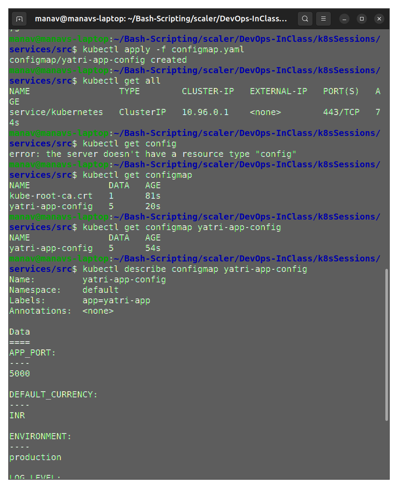
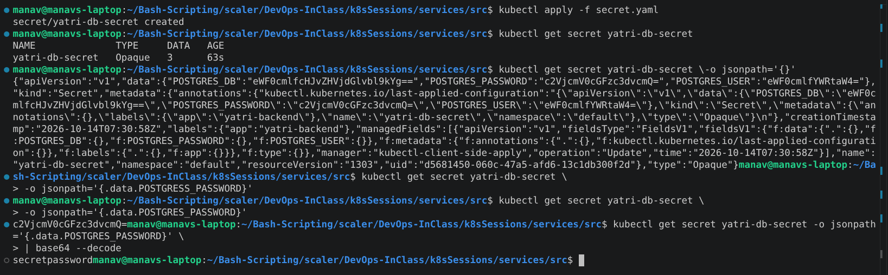
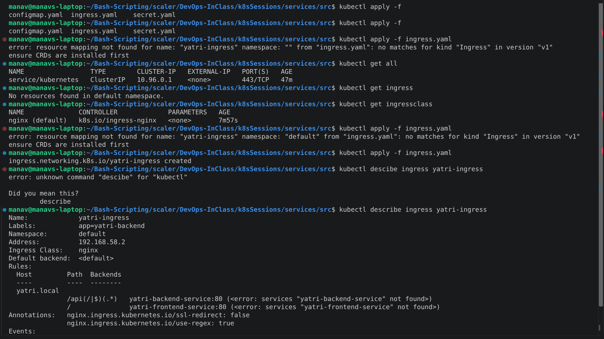

# Session 12: Ingress Controllers, ConfigMaps, Secrets & TLS Security

**Author:** Manav Pratap Singh  
**Course:** SST DevOps & Cloud [SWE]  
**Session:** 12 - Ingress, ConfigMaps & Secrets  
**Repository:** devops-heros / session12-k8s  


## ConfigMap

```yaml
apiVersion: v1
kind: ConfigMap
metadata:
  name: yatri-app-config
  namespace: default
  labels:
    app: yatri-app
data:
  ENVIRONMENT: 'production'
  LOG_LEVEL: 'INFO'
  APP_PORT: '5000'
  DEFAULT_CURRENCY: 'INR'
  MAX_BOOKING_DAYS: '30'
```




## Secret

```yaml
apiVersion: v1
kind: Secret
metadata:
  name: yatri-db-secret
  labels:
    app: yatri-backend
type: Opaque
data:
  POSTGRES_USER: eWF0cmlfYWRtaW4=
  POSTGRES_PASSWORD: c2VjcmV0cGFzc3dvcmQ=
  POSTGRES_DB: eWF0cmlfcHJvZHVjdGlvbl9kYg==
```



### Why secrets should not directly be committed to git?
Secrets committed to git are visible to bots and expose vulnerabilities that may lead to resource abuse and hence we use secrets which is specifically designed to store sensitive data.


## Ingress

```yaml
apiVersion: networking.k8s.io/v1
kind: Ingress
metadata:
  name: yatri-ingress
  namespace: default
  labels:
    app: yatri-backend
  annotations:
    nginx.ingress.kubernetes.io/ssl-redirect: "false"
    nginx.ingress.kubernetes.io/use-regex: "true"
spec:
  ingressClassName: nginx
  rules:
    - host: yatril.local
      paths:
      - path: /api(/|$)(.*)
        pathType: ImplementationSpecific
        backend:
          service:
            name: yatri-backend-service
            port:
              number: 80
      - path: /
        pathType: Prefix
        backend:
          service:
            name: yatri-frontend-service
            port:
              number: 80
```

